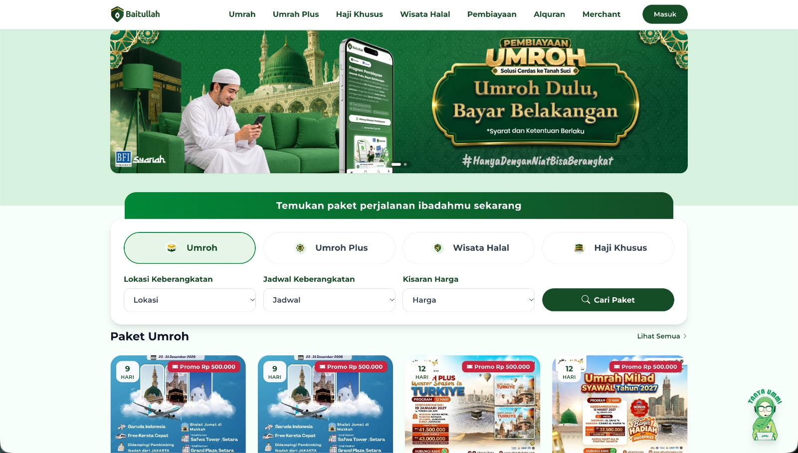
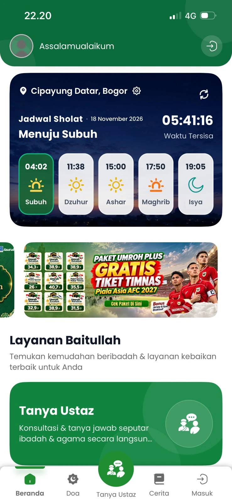

## Context

Baitullah is an online marketplace for Umrah and Hajj travel in Indonesia. Pilgrims search packages from many travel agents on the website, and in the MyBaitullah app, which also has prayer times, prayer guides and "Tanya Ustaz".

## What I did

- Built APIs with Laravel for the website and the MyBaitullah app.
- Consumed APIs from other services and integrated them into the product.
- Tested the APIs in Postman and kept the API documentation up to date.
- Trained travel partners to use the dashboard.
- Worked as Full Stack Developer and then QA Tester at Baitullah, so I could read the code behind a bug as well as report it.

## Screens

## Outcome

Worked on this product from July 2024 to March 2026.
