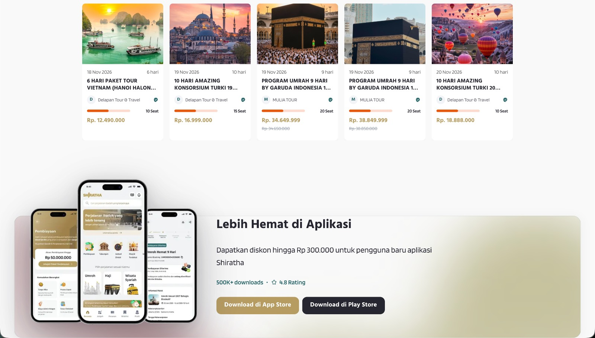
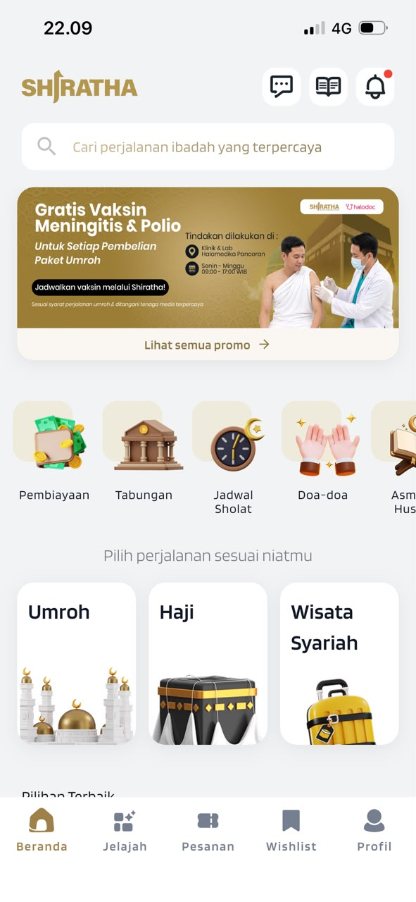

## Context

Shiratha is Treetan's consumer brand for Umrah and halal travel. Travellers compare packages from many travel agents (dates, prices, remaining seats) and book on the website or in the mobile app.

## What I did

- Tested all features of the platform, on the website and in the mobile app.
- Checked API performance in Apidog, with load scenarios run in k6.
- Wrote mobile test scripts and ran them with Appium.
- Logged defects with steps to reproduce and verified the fixes.

## Screens

## Outcome

Part of my current work as QA Tester at Treetan.
