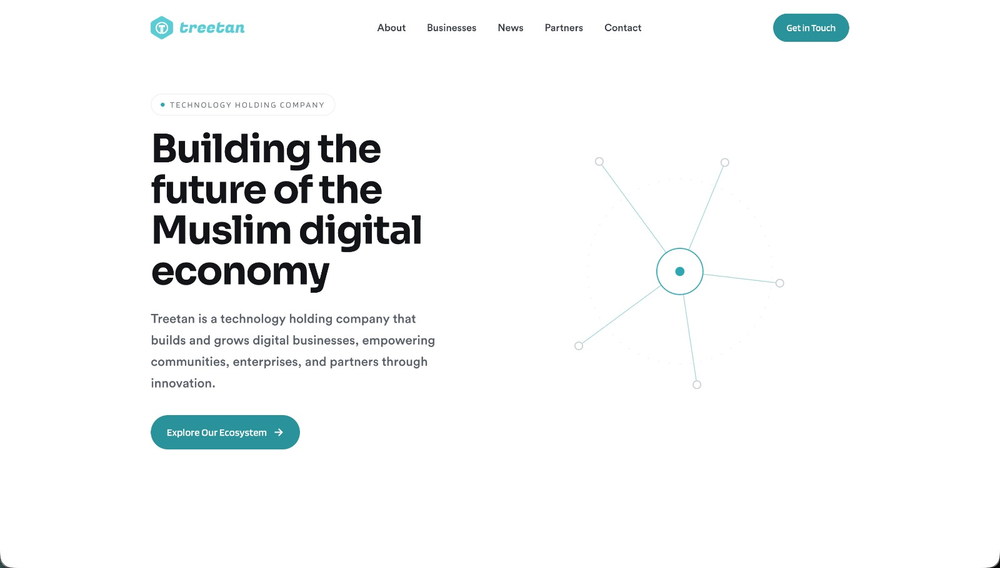
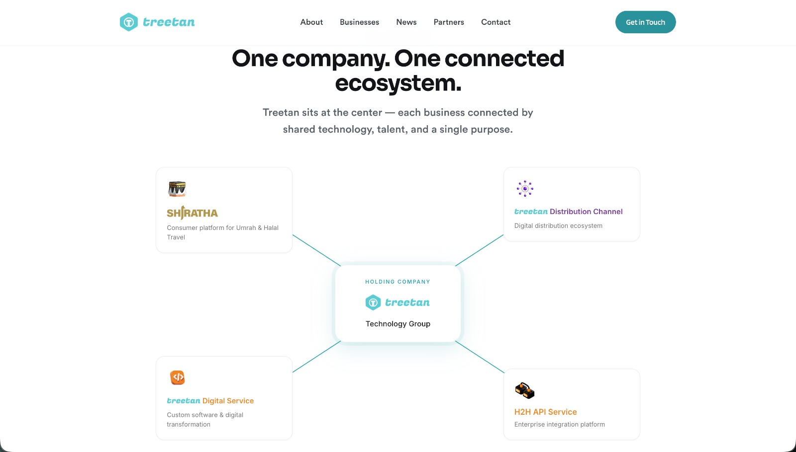
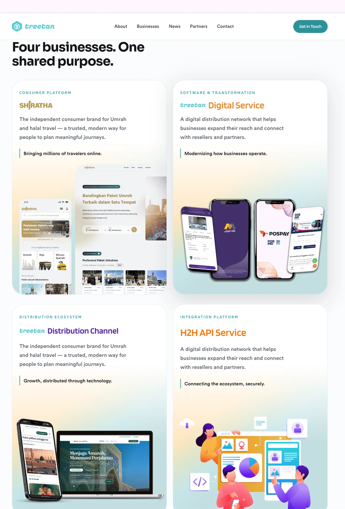

## Context

Treetan is a technology holding company building the Muslim digital economy. One company, four businesses: Shiratha (consumer Umrah and halal travel), Treetan Digital Service (software and digital transformation), Treetan Distribution Channel (a distribution network for resellers and partners) and H2H API Service (enterprise integration).

## What I did

- Tested every Treetan product manually, end to end: the corporate website, the admin dashboard, travel, Treetan Distribution Channel, consultant and white label.
- Covered the main flows and edge cases of each feature, and re-tested fixes before release.
- Reported defects with clear steps to reproduce, so developers could fix them quickly.

## Screens

## Outcome

My main project as QA Tester at Treetan (since April 2026).
