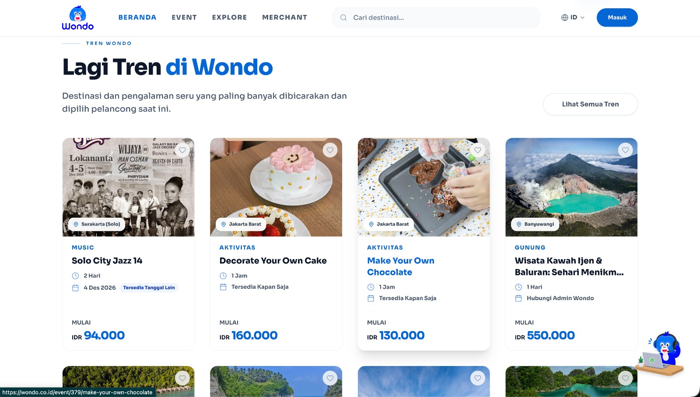
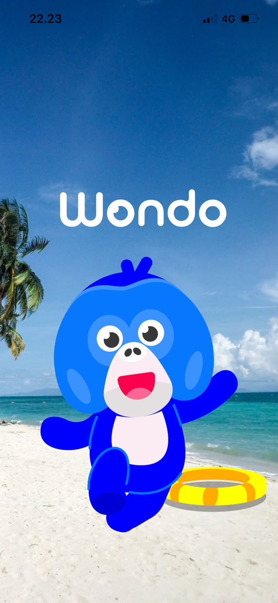
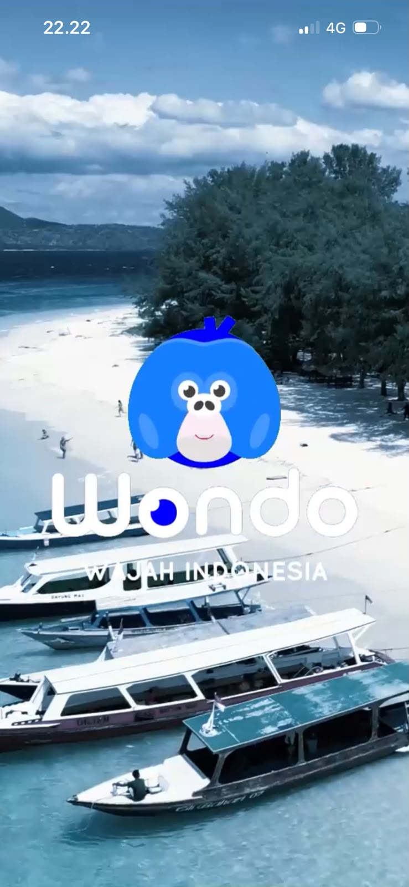

## Context

Wondo is a platform for finding events, activities and destinations in Indonesia, from concerts and workshops to mountain trips. It runs as a website and as two mobile apps: Wondo for travellers and Wondo Merchant for the businesses that offer the activities.

## What I did

- Built the APIs with Laravel for the website and both apps.
- Consumed APIs from other services and integrated them into the product.
- Tested the APIs in Postman.
- Wrote the API documentation for the team.

## Screens

 
